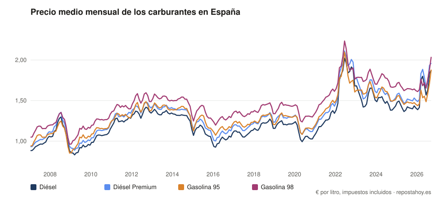

# Precio de la gasolina y el diésel en España: datos abiertos

Series históricas del **precio medio de los carburantes en España**: mensuales, semanales y diarias, para el conjunto del país y para **cada una de las 52 provincias**. En CSV, con licencia libre ([CC BY 4.0](LICENSE)) y **actualizadas cada día** de forma automática.

Los elabora [Reposta Hoy](https://www.repostahoy.es), un comparador independiente de precios de gasolineras, a partir de los datos abiertos que las gasolineras comunican al Ministerio para la Transición Ecológica y el Reto Demográfico.



## En cifras

<!-- AUTO:CIFRAS -->
- **Diésel**: 1,871 € de media en septiembre de 2026; 1,405 € hace 1 año (+33,2 %); 1,277 € hace 5 años (+46,5 %); 1,027 € hace 10 años (+82,2 %).
  El mes más caro de la serie fue junio de 2022 (2,023 €) y el más barato, marzo de 2009 (0,831 €).
- **Gasolina 95**: 1,881 € de media en septiembre de 2026; 1,474 € hace 1 año (+27,6 %); 1,426 € hace 5 años (+31,9 %); 1,152 € hace 10 años (+63,3 %).
  El mes más caro de la serie fue junio de 2022 (2,098 €) y el más barato, diciembre de 2008 (0,853 €).

Última semana completa (del 19 de octubre al 25 de octubre de 2026), sin Canarias, Ceuta ni Melilla:
- Diésel: la provincia más barata fue Lleida (1,845 €) y la más cara, Illes Balears (1,992 €); diferencia de 14,7 céntimos por litro.
- Gasolina 95: la provincia más barata fue Lleida (1,697 €) y la más cara, Illes Balears (1,846 €); diferencia de 14,9 céntimos por litro.
<!-- /AUTO:CIFRAS -->

## Qué hay aquí

<!-- AUTO:COBERTURA -->
| Archivo | Qué contiene | Filas | Desde | Hasta |
|---|---|---:|---|---|
| [`data/mensual_espana.csv`](data/mensual_espana.csv) | Media mensual de España (los 6 combustibles) | 1.268 | enero de 2007 | octubre de 2026 |
| [`data/semanal_espana.csv`](data/semanal_espana.csv) | Media semanal de España (4 combustibles líquidos) | 72 | 11 de octubre de 2021 | 19 de octubre de 2026 |
| [`data/diario_espana.csv`](data/diario_espana.csv) | Media diaria de España (4 combustibles líquidos) | 440 | 12 de julio de 2026 | 29 de octubre de 2026 |
| [`data/semanal_provincias.csv`](data/semanal_provincias.csv) | Media semanal de cada provincia (4 combustibles líquidos) | 3.726 | 11 de octubre de 2021 | 19 de octubre de 2026 |
| [`data/diario_provincias.csv`](data/diario_provincias.csv) | Media diaria de cada provincia (4 combustibles líquidos) | 22.770 | 12 de julio de 2026 | 29 de octubre de 2026 |
<!-- /AUTO:COBERTURA -->

Los ficheros de apoyo son [`provincias.csv`](data/provincias.csv) (las 52 provincias, con su nombre y si tienen impuestos propios sobre los carburantes) y [`combustibles.csv`](data/combustibles.csv) (los seis combustibles, con su unidad). Los metadatos, en formato [Data Package](https://datapackage.org), están en [`datapackage.json`](datapackage.json).

### Columnas

| Columna | Significado |
|---|---|
| `combustible` | `diesel`, `diesel_premium`, `gasolina_95`, `gasolina_98`, `glp` o `gnc` (ver `combustibles.csv`) |
| `provincia` | Identificador de la provincia (el de su dirección en repostahoy.es, por ejemplo `madrid` o `a-coruna`). Se une con `provincias.csv` |
| `precio_medio` | Precio medio, en **euros por litro** (el GNC, en **euros por kilo**), **impuestos incluidos** |
| `mes` | Mes, en formato `AAAA-MM` |
| `mes_completo` | `true` si el mes ya terminó; el mes en curso (`false`) cambia cada día hasta que acaba |
| `semana_inicio` | Lunes de la semana (de lunes a domingo, hora de Madrid). Solo hay semanas completas |
| `fecha` | Día (hora de Madrid). Solo hay días terminados: el de hoy no aparece hasta mañana |

## Cómo se calculan las cifras

- **Media simple.** Cada día, la media de los precios de **todas las gasolineras** de la zona que venden ese combustible, sin ponderar por ventas ni por tráfico. Es el precio que se encuentra de media en un surtidor, no el que se paga de media.
- **España** incluye todas las gasolineras, también las de Canarias, Ceuta y Melilla. Esos cuatro territorios (Las Palmas, Santa Cruz de Tenerife, Ceuta y Melilla) tienen **impuestos propios sobre los carburantes**, y sus precios no son comparables con los de la Península y Baleares: están marcados con `impuestos_propios` en `provincias.csv`.
- **Semana y mes** son la media de las medias diarias de esos días. Un mes necesita al menos 10 días con datos para aparecer.
- **Origen.** Las medias históricas se construyen a partir del archivo histórico de precios del Ministerio y de nuestras lecturas periódicas de sus datos abiertos. Esta carpeta no contiene precios por gasolinera, solo medias.
- **Combustibles.** Diésel (gasóleo A), diésel premium, gasolina 95 E5, gasolina 98 E5, GLP y GNC. No incluye otros productos que el Ministerio también recoge (las gasolinas E10, el gas natural licuado, el hidrógeno o los biocombustibles). Los cuatro líquidos tienen serie diaria y semanal; GLP y GNC, solo mensual.
- **Precisión.** Los valores se publican con tres decimales (una milésima de euro). Las medias semanales calculadas aquí con los valores diarios pueden diferir en una milésima de las del [informe semanal](https://www.repostahoy.es/informe-semanal).
- **Control de calidad.** Se descartan los valores fuera de un rango razonable (0,30–3,50 €) y las semanas o días incompletos.

### Limitaciones

- Los precios los comunican las propias gasolineras y a veces llegan con retraso o con errores.
- El conjunto de gasolineras cambia con el tiempo (abren y cierran), y las medias lo reflejan.
- Las series diarias y semanales por provincia dependen de los datos disponibles; si ves un hueco o un valor raro, [abre una incidencia](https://github.com/rogergongas8/repostahoy-datos/issues) y lo revisamos.

## Cómo usarlos

**Python (pandas)**

```python
import pandas as pd

base = "https://raw.githubusercontent.com/rogergongas8/repostahoy-datos/main/data/"
semanal = pd.read_csv(base + "semanal_provincias.csv", parse_dates=["semana_inicio"])

# Diésel por provincia, una columna por provincia
diesel = semanal[semanal.combustible == "diesel"].pivot(
    index="semana_inicio", columns="provincia", values="precio_medio")
print(diesel[["madrid", "barcelona", "melilla"]].tail())
```

**R**

```r
base <- "https://raw.githubusercontent.com/rogergongas8/repostahoy-datos/main/data/"
mensual <- read.csv(paste0(base, "mensual_espana.csv"))
```

**Excel o Google Sheets:** `=IMPORTDATA("https://raw.githubusercontent.com/rogergongas8/repostahoy-datos/main/data/mensual_espana.csv")`

## Preguntas frecuentes

**¿Por qué mi gasolinera cuesta distinto de la media?** Estas cifras son medias de miles de gasolineras. Dentro de una misma ciudad hay diferencias de decenas de céntimos entre marcas y zonas. Para ver los precios de cada gasolinera, con el historial de su precio, está [Reposta Hoy](https://www.repostahoy.es).

**¿Por qué no coincide con otra fuente?** Cada fuente elige su método (ponderar o no, qué territorios incluye, qué días cuenta). Aquí es media simple de todas las gasolineras que comunican precio, con impuestos.

**¿Hay datos anteriores?** La serie llega hasta donde llega el archivo que hemos cargado; la tabla de arriba indica el primer mes.

**¿Y el precio de hoy?** En [repostahoy.es/informe-semanal](https://www.repostahoy.es/informe-semanal) está el informe de cada semana y en [repostahoy.es](https://www.repostahoy.es) los precios de hoy por provincia, municipio y gasolinera.

## Cómo citar

Puedes usar estos datos libremente, citando la fuente y enlazando:

> Reposta Hoy. *Precio medio de los carburantes en España: series mensuales, semanales y diarias* [conjunto de datos]. https://github.com/rogergongas8/repostahoy-datos. Datos del Ministerio para la Transición Ecológica y el Reto Demográfico. Licencia CC BY 4.0. Consultado el día/mes/año.

GitHub genera la cita en BibTeX y APA desde el botón «Cite this repository» (usa [`CITATION.cff`](CITATION.cff)).

## Licencia

- **Datos y gráficos:** [Creative Commons Reconocimiento 4.0 (CC BY 4.0)](LICENSE). Puedes copiarlos, redistribuirlos y adaptarlos, también con fines comerciales, citando a *Reposta Hoy* y enlazando a este repositorio o a [repostahoy.es](https://www.repostahoy.es).
- **Código** (`scripts/`): [MIT](LICENSE-CODE).
- **Datos de origen:** los precios son los que las gasolineras comunican al Ministerio para la Transición Ecológica y el Reto Demográfico y se publican como datos abiertos en el [Geoportal de Hidrocarburos](https://geoportalgasolineras.es/). Su reutilización se rige por las condiciones del propio Ministerio.

## Cómo se actualiza

Una [acción de GitHub](.github/workflows/actualizar.yml) ejecuta cada día [`scripts/actualizar.py`](scripts/actualizar.py), que lee las series públicas de repostahoy.es, las valida, las **suma a lo que ya había** (así las series diarias, que la web solo muestra a 90 días, crecen aquí) y regenera los gráficos y las cifras de este README. Puedes ejecutarlo tú: `python scripts/actualizar.py` (Python 3.9 o superior, sin dependencias).

---

## English summary

Open data on **fuel prices in Spain**: monthly, weekly and daily average pump prices (diesel, premium diesel, 95 and 98 petrol, LPG, CNG) for Spain as a whole and for each of its 52 provinces, as CSV, updated daily. Prices are in euros per litre (CNG: euros per kilo), taxes included, as a simple average over all stations reporting to the Spanish Ministry for the Ecological Transition. Canary Islands, Ceuta and Melilla have their own fuel taxes and are flagged in `data/provincias.csv`. Licence: CC BY 4.0 — please cite *Reposta Hoy* (https://www.repostahoy.es) and link back.
